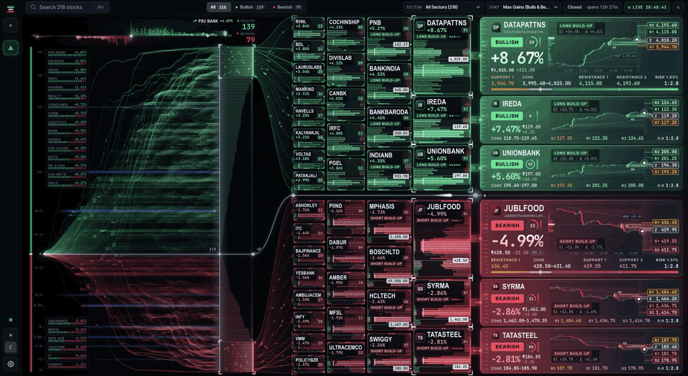
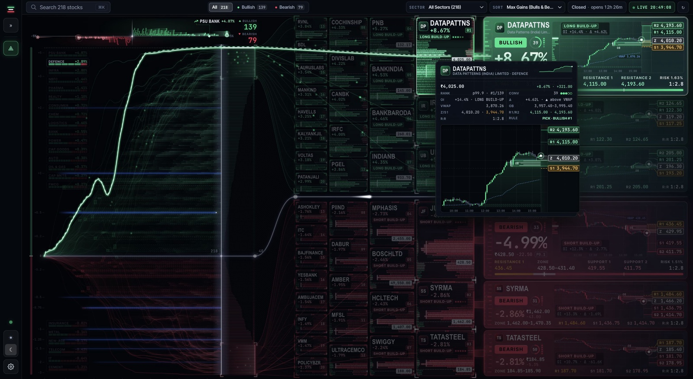
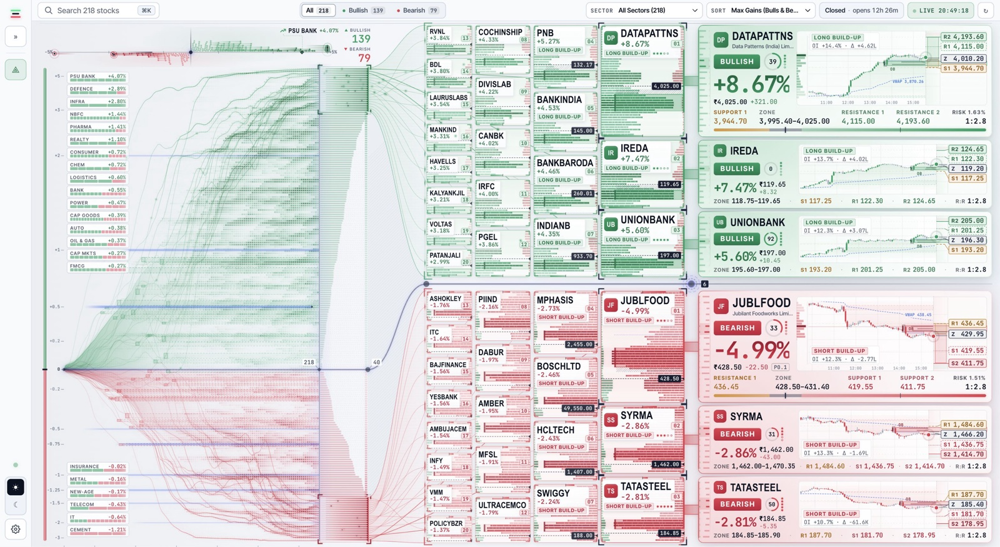

# Tredye Flow Alerts — Order Block & Order-Flow Terminal

A free, open-source ([MIT](LICENSE)) local alternative to [order-block.com/app/orderblock](https://order-block.com/app/orderblock) — a self-hosted Node.js service and real-time **Order Block Terminal** (`http://localhost:4600`) that monitors **218 NSE F&O stocks** during NSE market hours (`09:15–15:30 IST`), blends **Tredye Order Flow** (`cvd`, `poc`, `buildup`, 3m profiles) with **Upstox live quotes, depth, intraday candles & WebSocket V3 ticks**, and detects actionable **Order Blocks (`₹bot–top`)**.

> **Manual Review Only:** This project is for market research and manual chart review. It **never places orders** and is not financial advice.

---

## Preview



<details>
<summary>Static screenshots (Dark Mode Inspector &amp; Light Mode)</summary>

| Dark Mode (Hover Inspector &amp; OB Zone) | Light Mode |
| :---: | :---: |
|  |  |

</details>

---

## Features

- **Try Immediately Offline (`npm run demo`):** Built-in NSE sample dataset (`data/sample-fixture.js`) so anyone can explore the terminal without Upstox or Tredye credentials.
- **5-Stage Order-Flow Funnel (`/app/orderblock`):** Ranks 218 NSE F&O stocks across 5 confluence signals (`VWAP`, `POC`, `Buy%`, `CVD`, `Book Imbalance`), sector filters, side filters (`All`, `Bullish`, `Bearish`), and 3 ranking modes.
- **Volume-at-Price Tiles:** Each top-20 contender's tile is a real volume profile built from its 5-minute Upstox candles (POC, 70% value area, VWAP, Order Block zone), with an aggressive **buy / sell split** per price from the live WebSocket feed. See [Reading the Order Block Tiles](#reading-the-order-block-tiles).
- **Automated Order Block Detection:** Identifies unmitigated Bullish/Bearish Order Blocks on intraday candles with invalidation and proximity scoring (`IN_ZONE`, `RETESTED_HELD`, `UNTESTED`).
- **Live Upstox Integration:** Supports both **1-Year Analytics Tokens** and **Daily OAuth Login**, plus WebSocket V3 real-time ticks and 5-level market depth.
- **Local SQLite Persistence:** Stores alerts and terminal rule settings locally via Node's built-in `node:sqlite` (`data/tredye-alerts.db`).
- **Dark & Light Themes:** Defaults to your OS/browser preference with a sidebar theme toggle (`src/server/public/nav-rail.js`).

---

## Quick Start (No Credentials Required)

### Prerequisites
- **Node.js `>= 22.5`** (required for the built-in `node:sqlite` module)

### Clone, Install & Run Demo

```bash
git clone https://github.com/rohitprasad-code/tredye-noti.git
cd tredye-noti
npm install

# Start with built-in NSE sample data (no API keys needed)
npm run demo
```

Then open **http://localhost:4600** in your browser.

---

## Available Scripts

| Command | Description |
| :--- | :--- |
| `npm run demo` | Start the terminal on `:4600` using built-in sample data only (`--demo`) |
| `npm start` | Start the live service & dashboard (`node --env-file-if-exists=.env src/index.js`) |
| `npm run dev` | Same as `npm start` for local development |
| `npm run dry-run` | Print a single CLI summary of top setups & alerts and exit (`--dry-run`) |
| `npm test` | Run the test suite (`test/engine.test.js` + `test/fixes.test.js`, 40 tests) |
| `npm run next:dev` | Run the standalone Next.js App Router UI shell (`src/app/`) on port `3000` |
| `npm run build` | Build the Next.js App Router frontend (`next build`) |

> **Note:** `npm start` / `npm run demo` serves the complete Express backend, API endpoints, and terminal UI at `http://localhost:4600`.

---

## Pages & Navigation

- **`/` or `/app/orderblock` — Order Block Terminal:** Live 218-stock flow funnel, sector & side filters (`All`, `Bullish`, `Bearish`), 3 sort modes, 15m/5m candlestick & Order Block cards, hover inspector, and dark/light theme toggle.
- **`/app/edge` — Edge Report:** What price did after every live alert — 5/15/30/60-min and close returns, MFE/MAE, and whether T1 or the stop traded first — grouped by confluence, OB status, strength, time of day, type and sector.
- **`/app/settings` (or `/settings`) — Settings:** Accessible from the bottom **⚙ Settings** icon in the left sidebar. Configure **Upstox API** credentials (1-Year Analytics Token or OAuth login), **Display & Ambient FX**, and **Terminal Rules** (poll interval, Top-N, min confluence signals, OB proximity %, confirm polls, min price, watchlist, and ignore list).

---

## Connecting Live Data (Optional: Upstox + Tredye)

Without live credentials, the app falls back to the built-in **NSE Sample Replay** (`RELIANCE`, `ICICIBANK`, `BHARTIARTL`, `TATAMOTORS`, `INFY`, `TCS`, etc.).

### 1. Upstox Real-Time Quotes, Depth & WebSocket V3
1. Open **http://localhost:4600/app/settings** (or click **⚙** at the bottom of the left sidebar).
2. **Option A — 1-Year Analytics Token (Recommended):** Generate an Analytics Token in [Upstox Developer Apps](https://account.upstox.com/developer/apps), paste it under **One-Time Login**, and click **Save 1-Year Token**.
3. **Option B — Daily OAuth Login:** In the [Upstox Developer Console](https://account.upstox.com/developer/apps/createapp), set your app's **Redirect URL** to:
   ```text
   http://localhost:4600/api/upstox/callback
   ```
   Paste your **API Key** and **API Secret** on `/app/settings` and click **Save & Login with Upstox** (saved locally in `.env`).

### 2. Tredye Session (`.env`)
Copy `.env.example` to `.env` and set `TREDYE_EMAIL` + `TREDYE_PASSWORD` (or `TREDYE_COOKIE` from Chrome DevTools `Network` → `/api/orderflow` → `Cookie`).

```bash
cp .env.example .env
npm start
```

---

## Optional: macOS Background Service (`launchd`)

If you want to run the terminal continuously on macOS:
1. Copy `scripts/com.tredye.alerts.plist.example` to `scripts/com.tredye.alerts.plist` (or `~/Library/LaunchAgents/com.tredye.alerts.plist`).
2. Replace `/usr/local/bin/node` and `/path/to/tredye-noti` with your local paths.
3. Load it with `launchctl load ~/Library/LaunchAgents/com.tredye.alerts.plist`.

---

## Ranking Modes, Flow Scoring & Order Blocks

For full formulas and examples, see [docs/ORDER_FLOW_RANKING.md](docs/ORDER_FLOW_RANKING.md).

1. **5-Signal Confluence Check (`src/engine/flow.js`):**
   - `LTP > VWAP`
   - `LTP > POC` (Point of Control)
   - `Buy% > 50%`
   - `CVD > 0` (Cumulative Volume Delta)
   - `Book Imbalance > 0` (live Upstox `tbq`/`tsq` or `depth` levels)
2. **Strength Score (`0–100`):**
   Weights confluence agreement (`40%`), buy/sell dominance (`20%`), P90-normalized rupee CVD (`15%`), order-book imbalance (`10%`), and VWAP extension (`15%`).
3. **Setup Score (`0–100`):**
   Combines **60% Flow Strength**, **20% Price Momentum** (`|chgPct|` up to 5%), and **20% Aligned Order Block Proximity** (`IN_ZONE` = 20, `RETESTED_HELD <= 0.5%` = 17, `UNTESTED <= 0.5%` = 15, `<= 1.5%` = 10, active = 5).
4. **Terminal Sort Modes (`/app/orderblock`):**
   - **`Max Gains (Bulls & Bears)`** *(default)* — Pure `|chgPct|` descending (ties broken by `strengthScore` and directional flow).
   - **`Setup Score (Flow + OB)`** — Ranks by `setupScore` (`0–100`).
   - **`Strongest Flow`** — Ranks by `agree` count (`5/5` first) then `strengthScore`.
5. **Order Block Detection (`src/engine/orderblocks.js`):**
   - **Bullish OB (Buy Zone):** Last down candle (`close < open`) before a 1–3 candle impulse (`>= 1.8×` average candle range) breaking the prior 7-candle high.
   - **Bearish OB (Sell Zone):** Last up candle (`close > open`) before a 1–3 candle impulse (`>= 1.8×` average candle range) breaking the prior 7-candle low.

---

## Reading the Order Block Tiles

Each tile in the funnel (top 20 contenders per side) is a **volume-at-price ladder**: one horizontal bar per price level, highest price at the top. Nothing in it is simulated.

| Element | Meaning |
| :--- | :--- |
| **Bar length** | Volume traded at that price today, from the stock's real 5-minute candles (each candle's volume spread evenly across its high–low range). Measured against the stock's own average level, so the scale is the **same on every tile**: full width = 4× an average level. |
| **🟩 Green** | **Aggressive buy** volume — trades that lifted the offer (paid the ask). |
| **🟥 Red** | **Aggressive sell** volume — trades that hit the bid. |
| **⬜ Grey** | Volume whose side is **unknown**: it traded before the live feed started, or it could not be classified. |
| **White bar + `POC`** | Point of Control — the day's busiest price. |
| **Brighter bars + left-edge bracket** | Value area — the band holding 70% of the day's volume. |
| **End tick on a bar** | That level is above 4× average and is capped at full width. |
| **Empty rows** | Prices the stock did not trade today. |
| **Green / red box** | The Order Block zone. **Blue dotted line** = VWAP. **White chip** = LTP. |
| **`NO VOLUME DATA`** | No candles were available for that stock. |

**How to read it:** at a bullish Order Block, mostly **green** rows mean buyers defended the zone; mostly **red** means sellers were hitting it; mostly **grey** means there is not enough classified volume to judge. Hover a tile to see when the split started and what share of the day's volume is classified.

**Buy / sell split limits** (`src/engine/aggressor.js`):
- It needs the live Upstox WebSocket feed and covers only the time **since the feed connected** — start at 11:00 and 09:15–11:00 stays grey.
- It is held in memory, so **restarting the server mid-session clears it**.
- The feed is a snapshot stream, not every print: volume between two snapshots is booked to one side at the snapshot's LTP. It is a sound estimate of who was aggressive, not an exchange-grade footprint.

---

## Background Alert Types

- **🎯 `IN_ZONE`:** Strong flow (`>= minAgree`) while price trades inside an aligned Order Block.
- **⚡ `APPROACHING_OB`:** Strong flow (`>= minAgree`) within `obProximityPct` (`0.5%` default) of an active aligned Order Block.
- **🟢/🔴 `NEW_STRONG_FLOW`:** Sustained Top-N flow across `confirmPolls` consecutive polls.
- **⚠️ `FLOW_FLIP`:** Previously alerted symbol flips to strong opposing flow.
- **⏰ `REMINDER_DUE`:** Re-evaluates scheduled reminder timers (`STILL HOLDS ✅`, `NOW IN OB ZONE 🎯`, or `FLIPPED ❌`).

---

## Project Structure

```text
├── config.json                     # Default terminal rules
├── data/                           # Sample fixture, instrument map & local SQLite DB (ignored)
├── docs/ORDER_FLOW_RANKING.md      # Detailed ranking & scoring formulas
├── scripts/                        # Example macOS launchd plist template
├── src/
│   ├── app/ & src/components/      # Next.js App Router views (OrderBlock & Settings)
│   ├── client/                     # Modular frontend CSS/JS bundles
│   ├── config/                     # .env & config.json loaders
│   ├── engine/                     # Flow scoring, Order Block detection, ranking & signals
│   ├── market/                     # NSE market hours & holiday schedule (IST)
│   ├── server/                     # Express server, SSE stream & static HTML shells
│   ├── service/                    # Polling loop & live/demo orchestration
│   ├── store/                      # SQLite persistence (node:sqlite)
│   ├── tredye/                     # Tredye order-flow API client
│   └── upstox/                     # Upstox REST, OAuth, JWT & WebSocket V3 proto client
└── test/engine.test.js             # Unit & integration test suite
```

---

## License

[MIT](LICENSE)
